

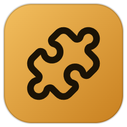

# RimWorld Mod Library

**Use the Steam Workshop with your Epic Games or GOG copy of RimWorld.** 
Browse, install, update and sort mods in one modern desktop app. No Steam account needed.

 

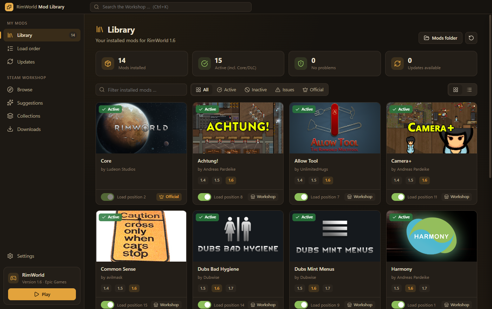

---

## Contents

- [Why?](#why)
- [Features](#features)
- [How it works](#how-it-works)
- [Installation](#installation)
- [Getting started](#getting-started)
- [Themes](#themes)
- [Languages](#languages)
- [Important notes](#important-notes)
- [FAQ](#faq)
- [License](#license)

---

## Why?

The Steam Workshop is where nearly all RimWorld mods live, but it only works with the Steam version of the game. If you own RimWorld on **Epic Games** or **GOG**, you normally have to download every mod by hand, unpack it, find its dependencies and fix the load order yourself.

**RimWorld Mod Library does all of that for you.**

---

## Features

<table>
  <tr>
    <td width="50%" valign="top">
      <h3>📚 Library</h3>
      All installed mods with preview images, authors and supported versions. Turn mods on and off with a single switch, filter by status and spot problems right away.
    </td>
    <td width="50%" valign="top">
      <h3>🔎 Workshop browser</h3>
      Search the Steam Workshop with filters for trending, most popular, newest and recently updated. Show only mods that support your game version.
    </td>
  </tr>
  <tr>
    <td>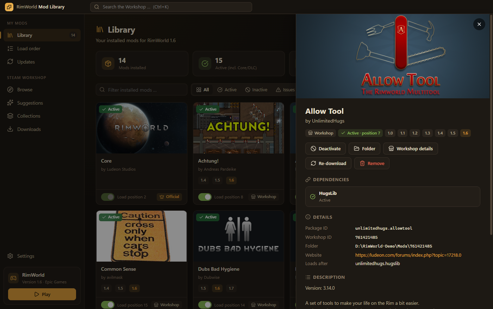</td>
    <td>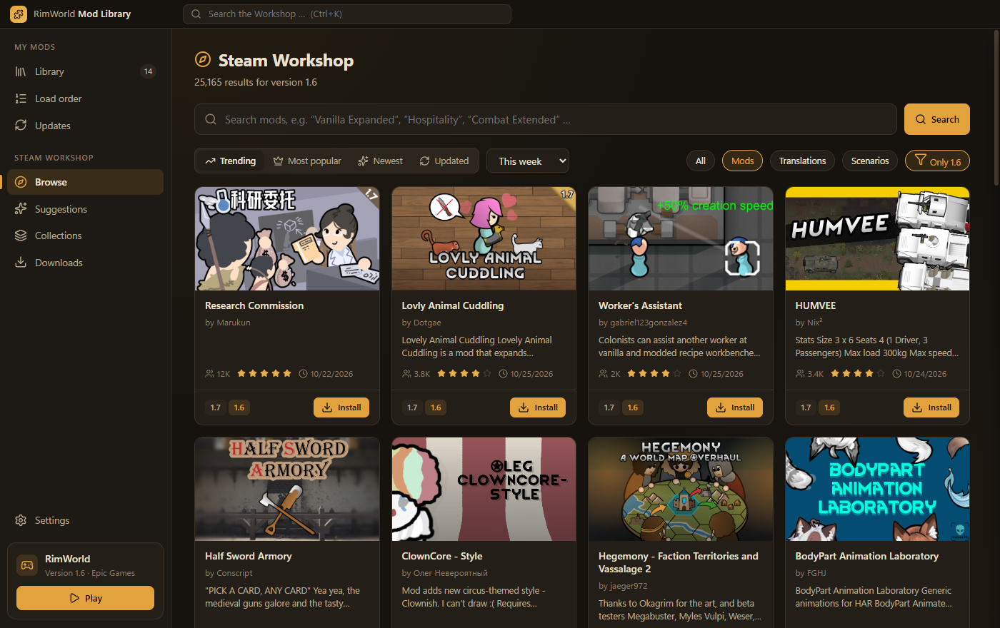</td>
  </tr>
  <tr>
    <td width="50%" valign="top">
      <h3>🧩 Automatic dependencies</h3>
      Required mods such as Harmony, HugsLib or Vanilla Expanded Framework are found and installed automatically, including dependencies that are only declared in a mod's <code>About.xml</code>.
    </td>
    <td width="50%" valign="top">
      <h3>↕️ Load order</h3>
      Drag &amp; drop, one-click auto-sort and clear warnings for missing or inactive dependencies, wrong order, incompatible mods and version mismatches.
    </td>
  </tr>
  <tr>
    <td>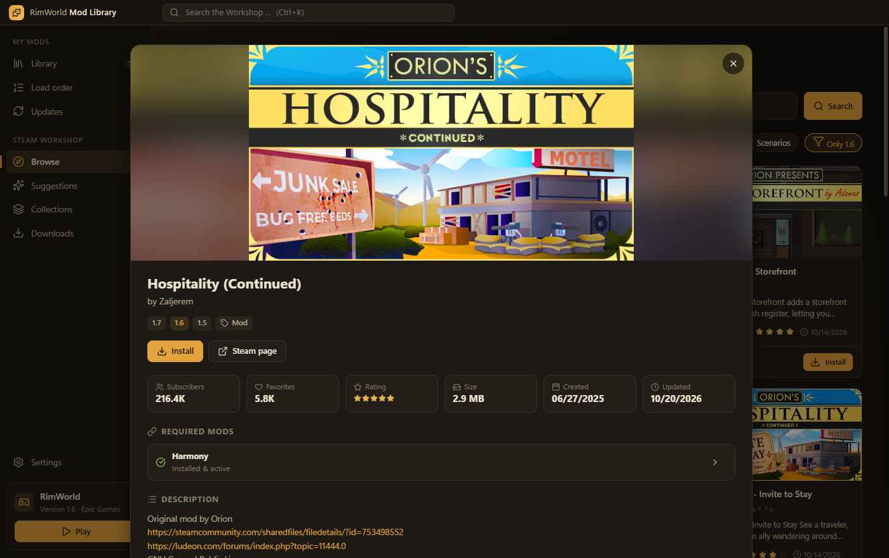</td>
    <td>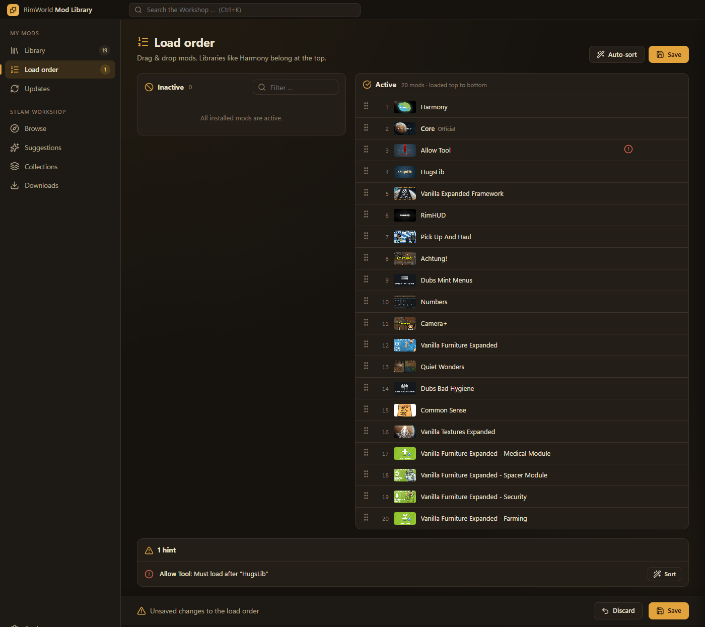</td>
  </tr>
  <tr>
    <td width="50%" valign="top">
      <h3>✨ Suggestions</h3>
      Missing dependencies, a hand-picked starter set of essential mods, this week's trending mods and the all-time favorites, all filtered to what you don't have yet.
    </td>
    <td width="50%" valign="top">
      <h3>🔄 Updates</h3>
      Detects when a Workshop mod has been updated and updates one or all of them with a single click.
    </td>
  </tr>
  <tr>
    <td>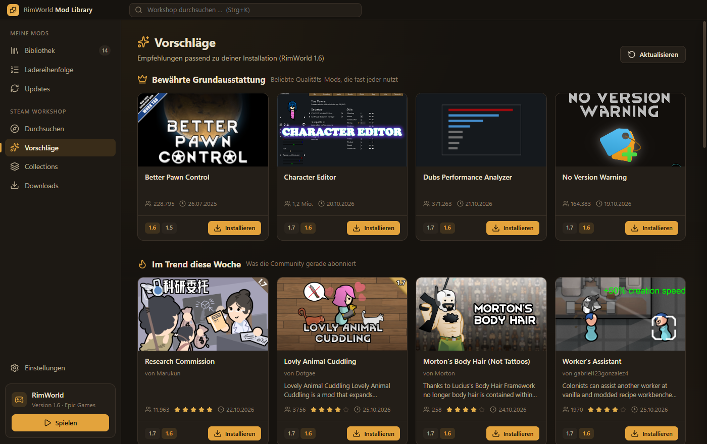</td>
    <td>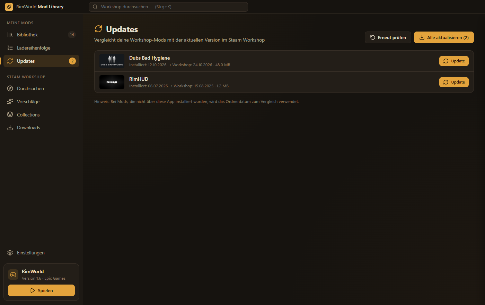</td>
  </tr>
  <tr>
    <td width="50%" valign="top">
      <h3>🗂️ Collections</h3>
      Paste the link of a Workshop collection, for example a streamer's modpack, choose what you want and install everything at once.
    </td>
    <td width="50%" valign="top">
      <h3>⬇️ Download queue</h3>
      See the progress of every download. Dependencies are marked, and failed downloads can be retried.
    </td>
  </tr>
  <tr>
    <td>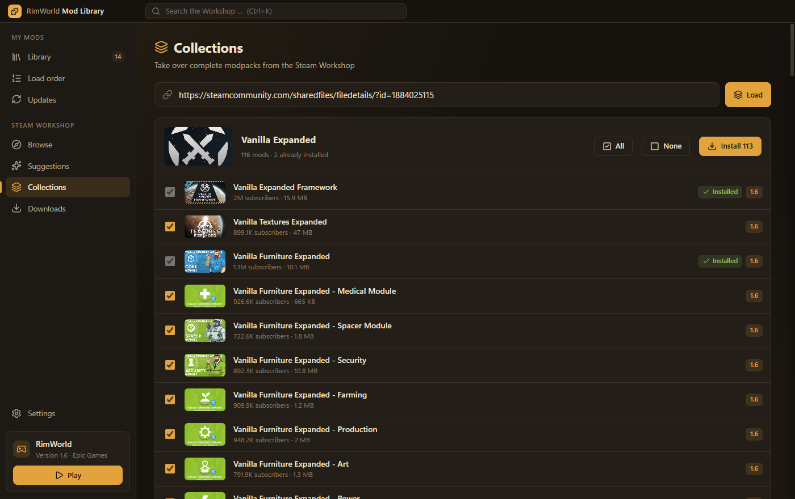</td>
    <td>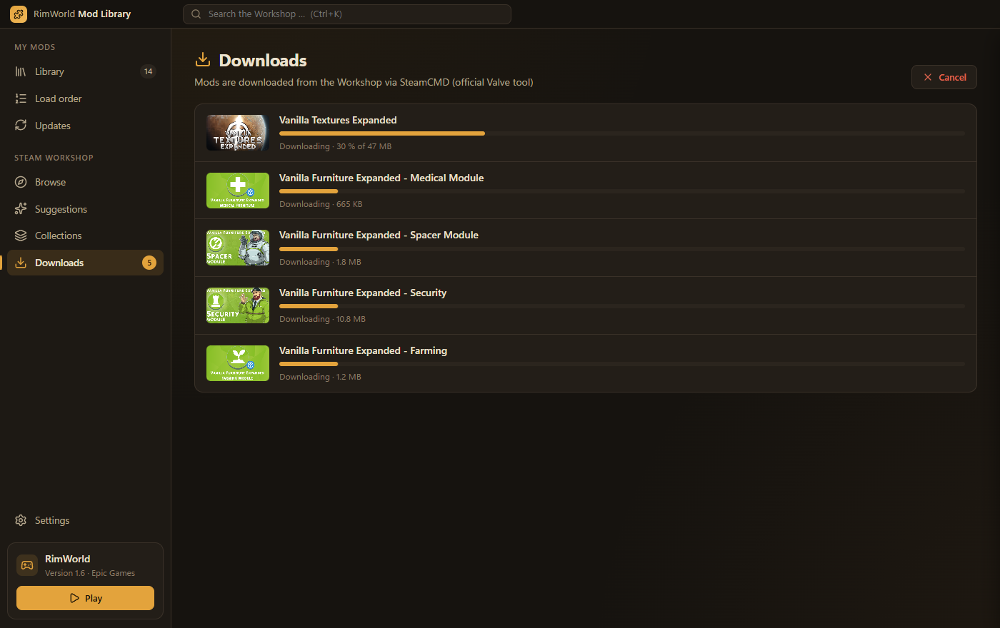</td>
  </tr>
</table>

**Also included:**

- ▶️ **Play button** that starts RimWorld through the Epic Games Launcher or directly
- 🔍 **Global search** with <kbd>Ctrl</kbd> + <kbd>K</kbd>
- 🗑️ **Safe uninstall**: removed mods go to the Recycle Bin
- 💾 **Automatic backup** of `ModsConfig.xml` before every change
- 🧭 **Auto-detection** of Epic, GOG and Steam installations and your game version
- 🌐 **English and German** interface, switchable at any time
- ℹ️ **About page** with app and RimWorld version, an update check against GitHub releases, links to report bugs, credits and licenses

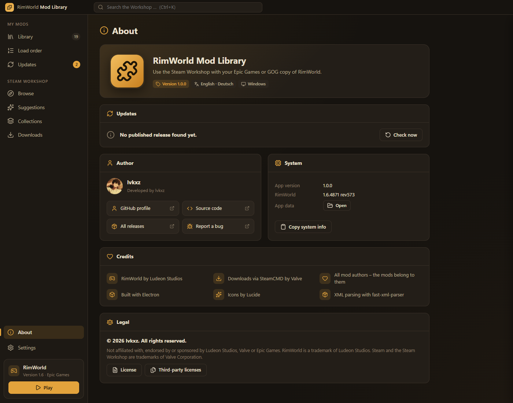

---

## How it works

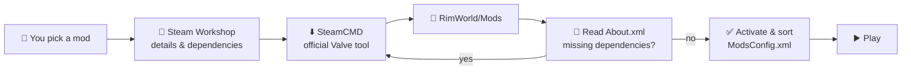

1. **Search and details** come from the public Steam Workshop pages and the public Steam Web API. No API key is needed.
2. **Downloads** go through [SteamCMD](https://developer.valvesoftware.com/wiki/SteamCMD), Valve's official command-line client, with an **anonymous** login. You don't need a Steam account and you don't have to own the game on Steam.
3. SteamCMD is **not bundled**. On the first download the app fetches it directly from Valve's servers and sets it up. This takes about one minute, once.
4. Mods are placed in your game's `Mods` folder and activated in `ModsConfig.xml`, the same file RimWorld itself uses.

---

## Installation

> [!NOTE]
> The app is for **Windows 10 and 11 (64-bit)**. It starts in **English**; you can switch to **German** under **Settings → Language**.

1. Open the [**latest release**](https://github.com/lvkxz/RimWorld-Mod-Library/releases/latest).
2. Download one of these:

   | File | Description |
   |---|---|
   | `RimWorld-Mod-Library-Setup-x.y.z.exe` | **Recommended.** Installer with Start menu and desktop shortcuts and a normal uninstaller. |
   | `RimWorld-Mod-Library-Portable-x.y.z.exe` | No installation. Runs from any folder or a USB stick. |

3. Run the file.

> [!WARNING]
> **Windows SmartScreen:** The app is not code-signed, because a signing certificate costs money. When you start it for the first time, Windows may show *"Windows protected your PC"*. Click **More info → Run anyway**. If you'd rather check the code first, it's all in this repository.

---

## Getting started

1. **Start the app.** It finds your RimWorld installation automatically. If it doesn't, choose the folder under **Settings**.
2. **Find mods:** Go to **Browse**, or open **Suggestions** for a good starter set.
3. **Click Install.** Dependencies are added automatically. On the very first download, SteamCMD is set up, which takes about a minute.
4. **Check the load order** under **Load order**. Click **Auto-sort** if a warning appears.
5. **Click Play** and have fun. 🎉

<b>Where does the app store its files?</b>

| What | Location |
|---|---|
| Installed mods | `<RimWorld folder>\Mods\<Workshop ID>` |
| Active mod list | `%USERPROFILE%\AppData\LocalLow\Ludeon Studios\RimWorld by Ludeon Studios\Config\ModsConfig.xml` |
| Backup of the mod list | `ModsConfig.xml.bak`, in the same folder |
| App settings and SteamCMD | `%APPDATA%\RimWorld Mod Library` |

---

## Themes

Choose your style under **Settings → Appearance**:

<table>
  <tr>
    <th>RimWorld</th>
    <th>Dark</th>
    <th>Light</th>
  </tr>
  <tr>
    <td></td>
    <td>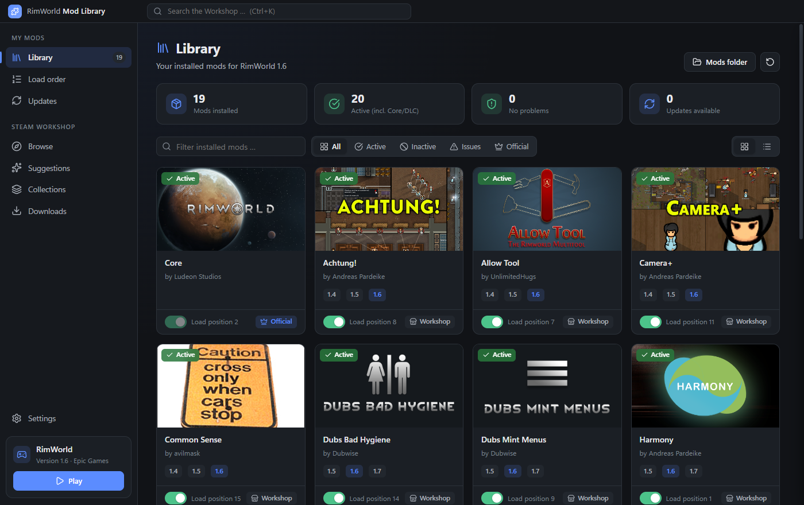</td>
    <td>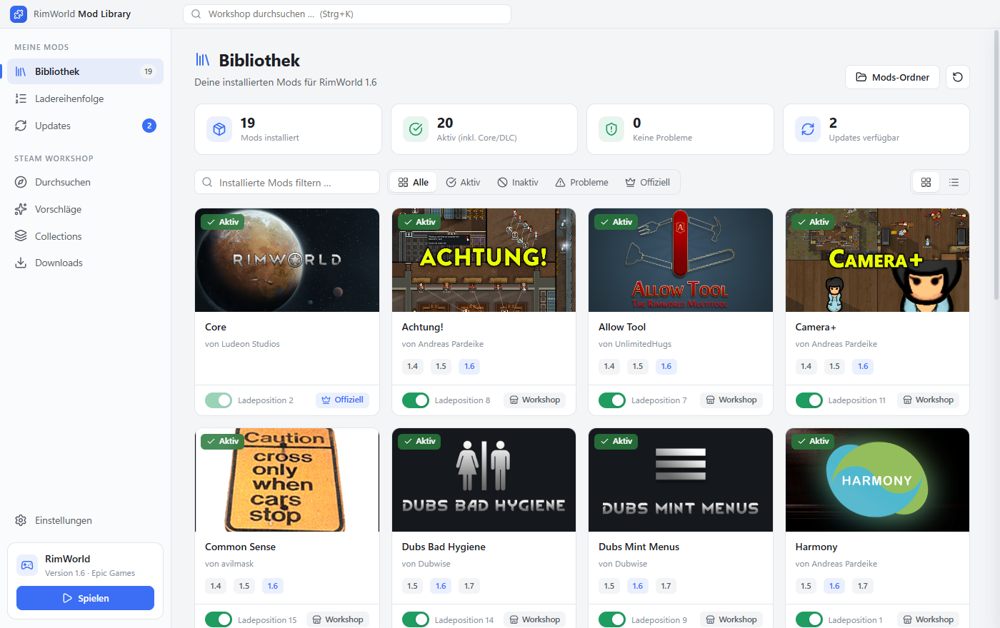</td>
  </tr>
</table>

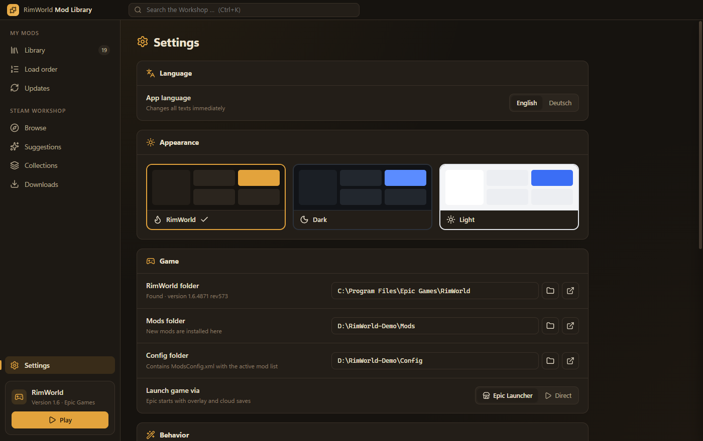

---

## Languages

The app is available in **English** (default) and **German**. Switch under **Settings → Language**. All texts change instantly, including hints and error messages, and the choice is remembered.

<table>
  <tr>
    <th>English</th>
    <th>Deutsch</th>
  </tr>
  <tr>
    <td></td>
    <td>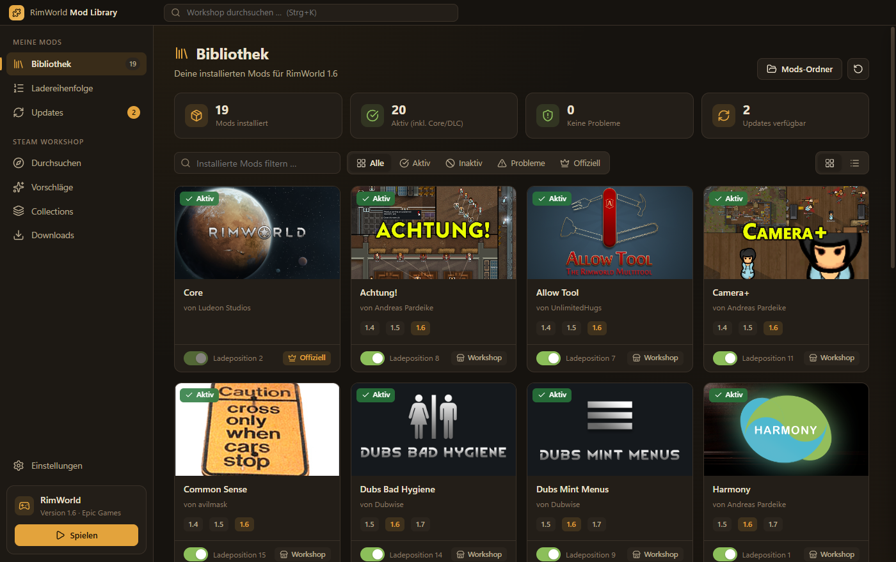</td>
  </tr>
</table>

---

## Important notes

> [!IMPORTANT]
> **Close RimWorld before changing your mods.** RimWorld writes its mod list when it exits and would overwrite your changes. The app detects a running game and won't save until you close it.

- **Not affiliated:** This project is not affiliated with, endorsed by or sponsored by Ludeon Studios, Valve, Epic Games or any mod author. RimWorld is a trademark of Ludeon Studios. Steam and the Steam Workshop are trademarks of Valve Corporation.
- **Mods belong to their authors.** This app only downloads them. If you enjoy a mod, please support its author on its Steam page with a rating, a comment or a donation.
- **DLCs:** Some mods need Royalty, Ideology, Biotech, Anomaly or Odyssey. The app warns you about this in the mod details. Make sure you own the DLC on your platform.
- **Use at your own risk:** Mods can break save games, and that's true with every mod manager. Back up important saves before big changes.
- **Steam can change things:** The app relies on public Steam pages and SteamCMD. If Valve changes them, some features may stop working until the app is updated.
- **Privacy:** There is no telemetry and no account. The app only talks to Steam and Valve servers to search and download mods.

---

## FAQ

<b>Do I need a Steam account or to own RimWorld on Steam?</b>

 
No. SteamCMD logs in anonymously, and RimWorld Workshop items can be downloaded that way.

<b>Does it work with the GOG or DRM-free version?</b>

 
Yes. Choose your RimWorld folder under <b>Settings</b> if it isn't detected automatically.

<b>A download fails with "Download timed out".</b>

 
Large mods sometimes time out on Steam's side. The app retries automatically up to three times. If it still fails, click <b>Retry</b> in the download list.

<b>A mod shows a red warning sign.</b>

 
Open the mod, because the details explain the problem. Usually a dependency is missing or loads in the wrong order. Missing dependencies can be installed with one click, and <b>Auto-sort</b> fixes the order.

<b>How do I know when there's a new version?</b>

 
The <b>About</b> page checks GitHub for a newer release every time the app starts. If there is one, a <b>New</b> badge appears next to <b>About</b> in the sidebar, and you can download the update from there.

<b>How do I report a bug?</b>

 
Open <b>About</b>, click <b>Copy system info</b> and then <b>Report a bug</b>. Paste the copied info into the GitHub issue. It contains only version numbers and your Windows version, no personal data or folder paths.

<b>How do I uninstall the app?</b>

 
Use <i>Windows Settings → Apps</i>, or just delete the portable exe. Your mods stay in the RimWorld <code>Mods</code> folder. To remove the app's settings and SteamCMD as well, delete <code>%APPDATA%\RimWorld Mod Library</code>.

---

## License

Copyright © 2026 lvkxz. **All rights reserved.**

The app is free to download and use. The source code is published for transparency only; it may not be copied, modified or redistributed without permission. See [LICENSE](LICENSE) for the full terms and [THIRD_PARTY_NOTICES.md](THIRD_PARTY_NOTICES.md) for the open-source components that are included.

 
Built with Electron and Lucide icons. Made for the RimWorld community. 🛠️

